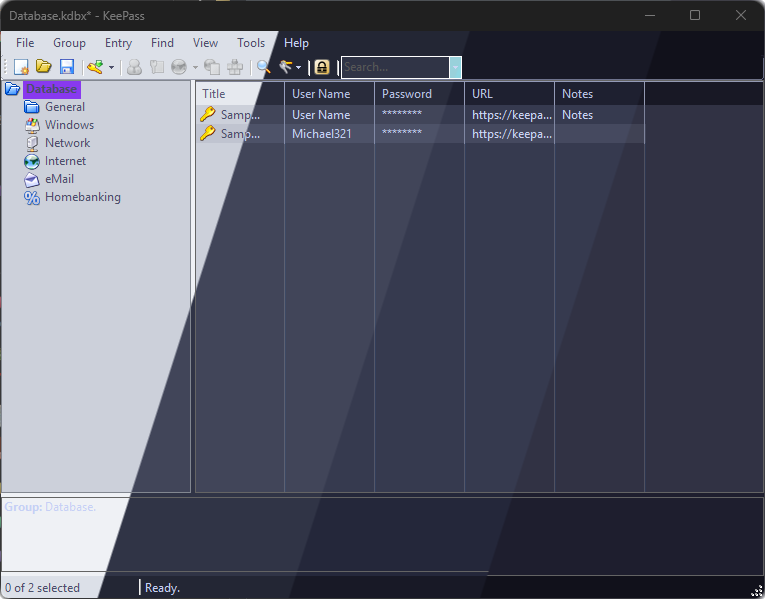
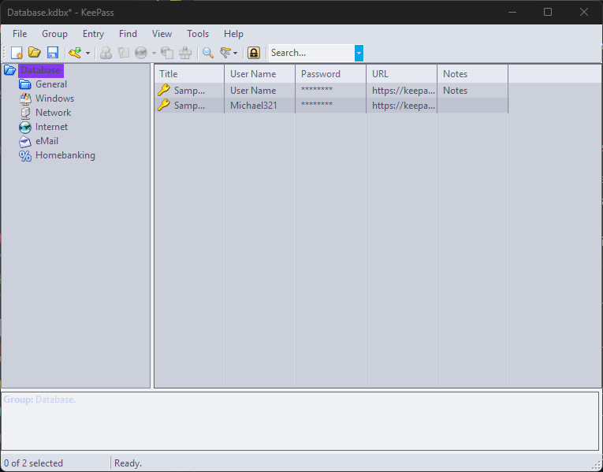
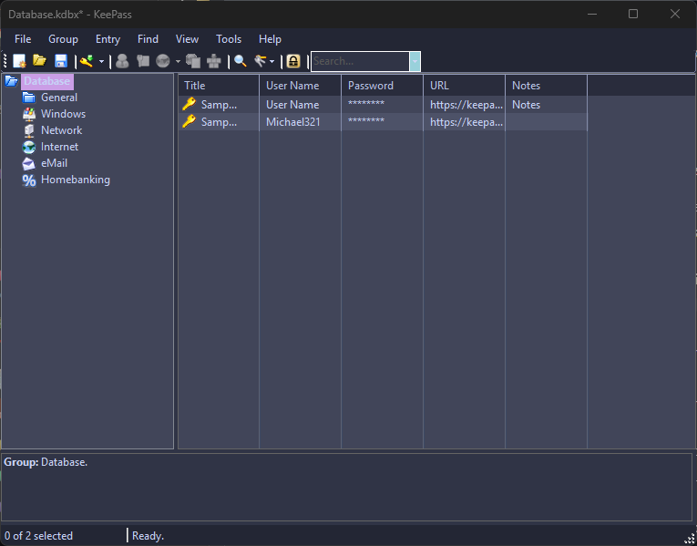
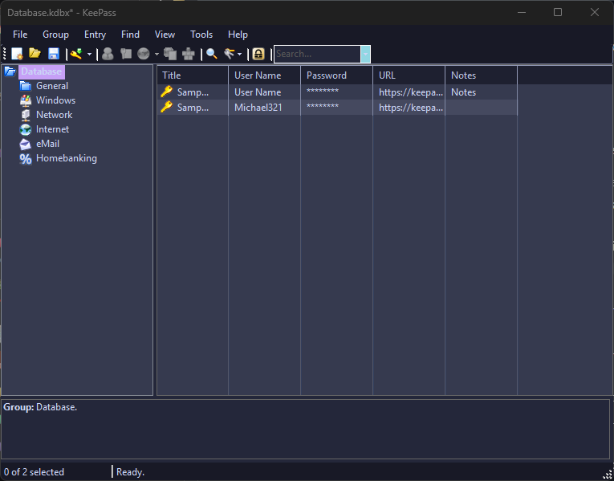
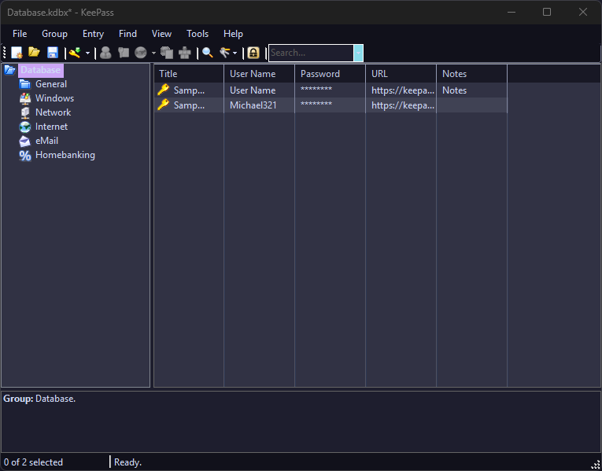

<h3 align="center">
   
  
  Catppuccin for <a href="https://keepass.info/index.html">KeePass 2</a>
  
</h3>

  
  
  

  

## Previews

🌻 Latte

🪴 Frappé

🌺 Macchiato

🌿 Mocha

## Usage

1. Install the [KeeTheme](https://github.com/xatupal/KeeTheme) Plugin in KeePass.
2. Download the `<Theme>.ini` file for the flavor of your choice (for example [Mocha](themes/Catppuccin%20Mocha.ini)).
3. Move the `<Theme>.ini` file into the plugins directory of KeePass 2 (usually located in `C:\Program Files\KeePass Password Safe 2\Plugins`).
4. Go into `Tools > Options > KeeTheme` and choose your theme in the `KeeTheme template` dropdown menu.

## 🙋 FAQ

- Q: **_"How can I change the highlight colors?"_**\
  A: To change the highlight colors, the best option is to directly change the color code in the `<Theme>.ini` file.
  As the _KeeTheme_ plugin doesn't support comments, you have to find the colors you want changed by their RGB code.
  To make it easier, the [Palette](palette) directory includes palettes for each flavor.
  Then just replace the color code in the `[Palette]` section with the color you want.

## 💝 Thanks to

- [Sebimohr](https://github.com/sebimohr)

&nbsp;

  

  Copyright &copy; 2021-present <a href="https://github.com/catppuccin" target="_blank">Catppuccin Org</a>

  

